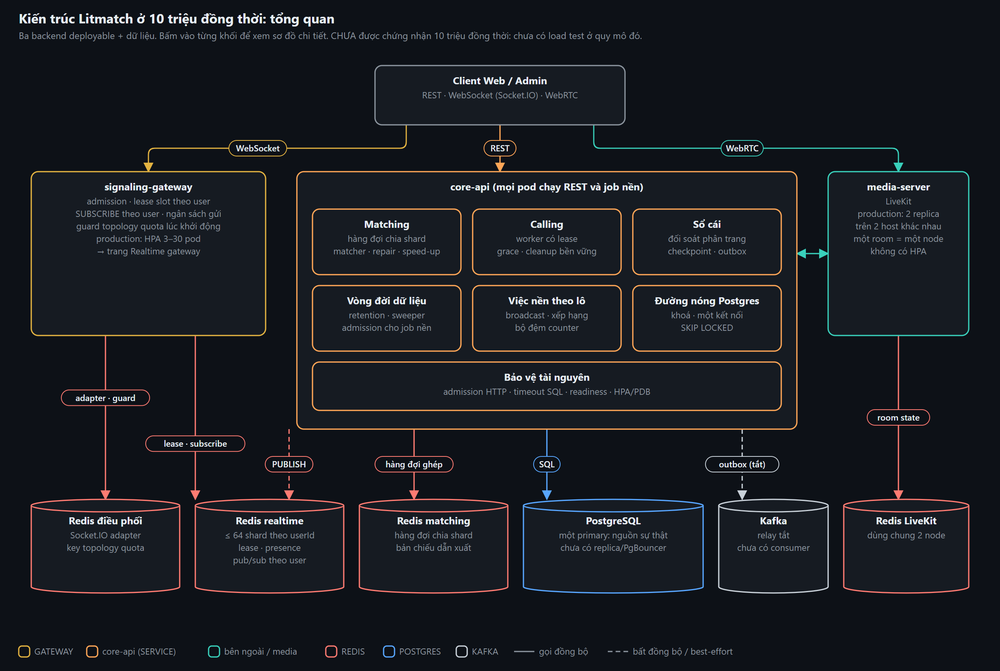
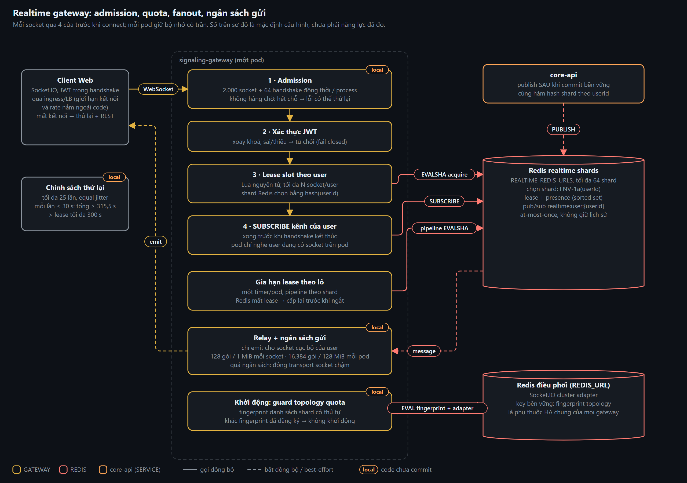
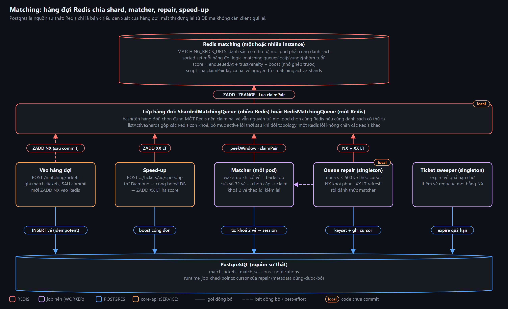
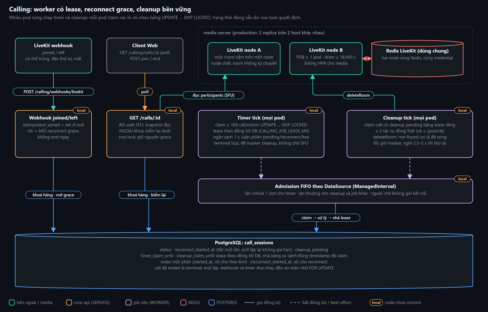
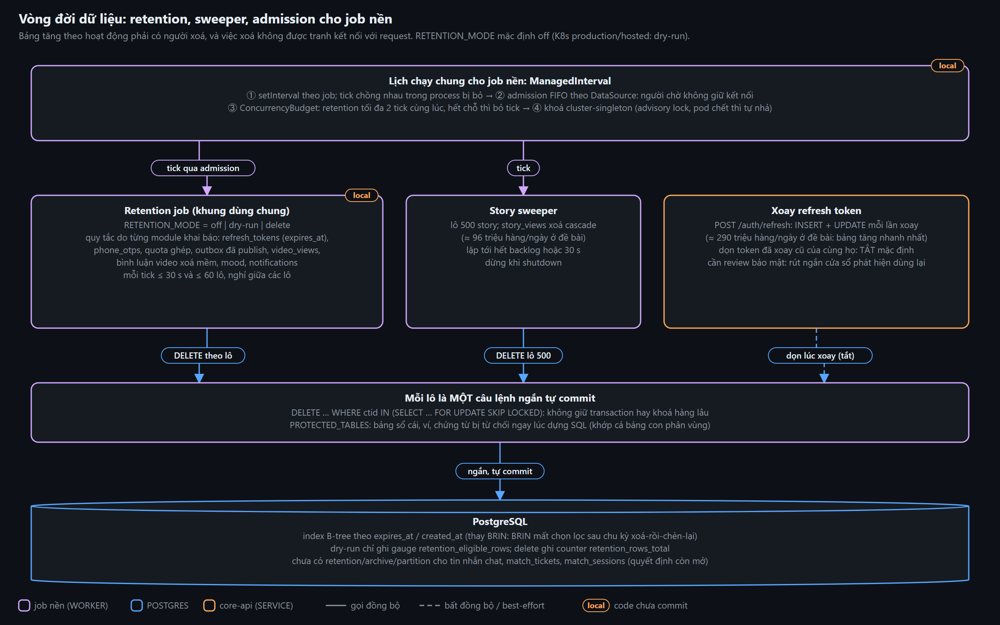
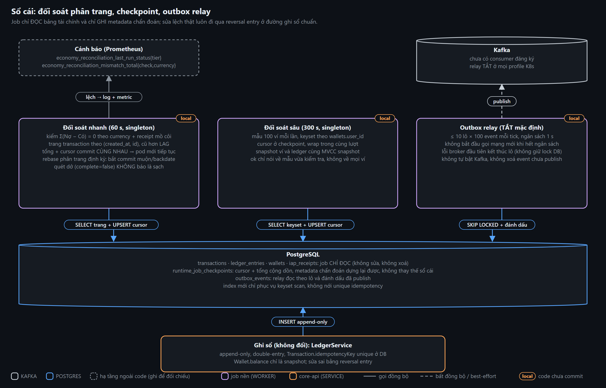
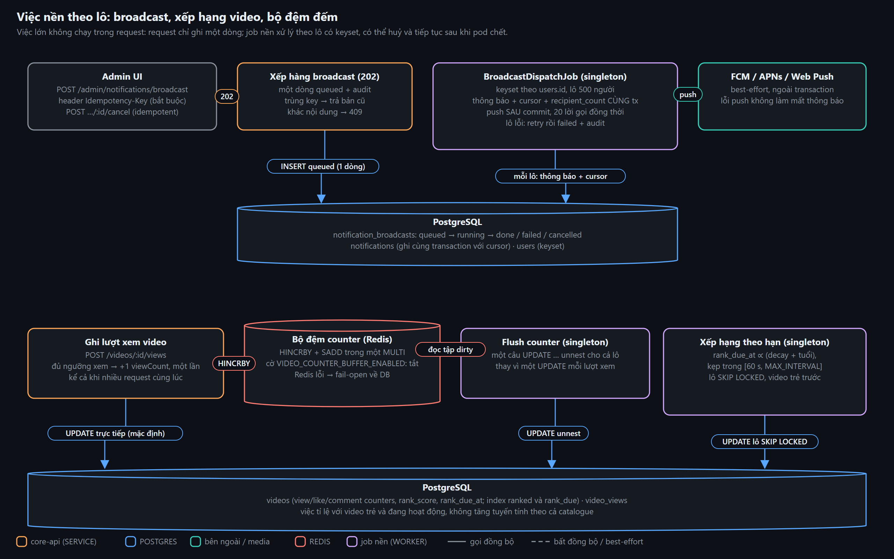
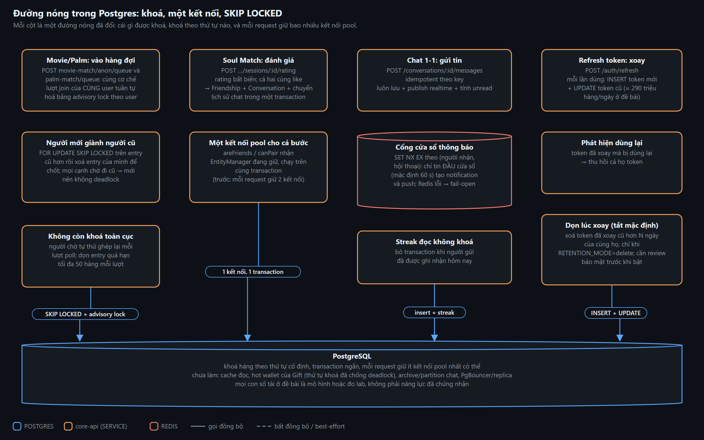
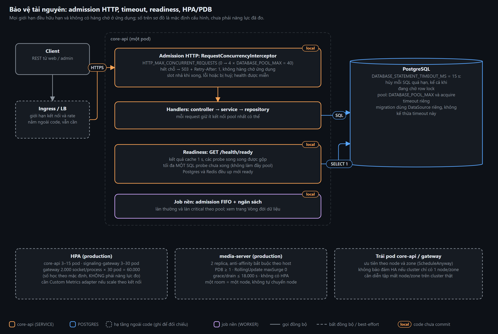

# Kiến trúc Litmatch ở 10 triệu đồng thời: tổng quan

Hệ thống giữ đúng ba backend deployable (core-api, signaling-gateway, media-server). Phần đã đổi để hướng tới 10 triệu kết nối đồng thời là cách chia dữ liệu và cách điều phối việc: Redis chia shard theo user, hàng đợi ghép tự phục hồi từ Postgres, job nền có admission và lease, vòng đời dữ liệu có công tắc an toàn, và mọi giới hạn đều hữu hạn và không có hàng chờ ở ứng dụng.

**Trạng thái trung thực:** Hệ thống CHƯA được chứng nhận 10 triệu đồng thời: chưa có load test ở quy mô đó, chưa diễn tập failover Redis/Postgres/media. Mọi con số trên các sơ đồ là mặc định cấu hình, số học theo mặc định hoặc đo lab (Docker, một kết nối, dữ liệu trong cache); chúng cho biết hướng, không phải năng lực production.

Nguồn của từng trang code: "đã đẩy (PR #84)" = khớp commit `0c052aa`; "local, chưa commit" = dùng file có thay đổi chưa commit (chụp 2026-10-21), chưa có trên GitHub.

## Realtime gateway: admission, quota, fanout, ngân sách gửi

Gateway không có logic nghiệp vụ và không đọc DB: nó xác thực JWT, giữ quota kết nối của từng user trên Redis và chuyển sự kiện từ Redis tới đúng socket. Ở 10 triệu socket, mỗi socket không được tốn một timer hay một lệnh Redis riêng, mỗi sự kiện không được đánh thức mọi pod, và một socket chậm không được làm đầy bộ nhớ của pod.

**Điểm quan trọng**

- Bốn cửa trước khi connect: admission → JWT → lease slot → SUBSCRIBE kênh của user. Lỗi ở bước sau thì hoàn tác bước trước (trả lease ngay, không đợi transport đóng).
- Admission hữu hạn, không hàng chờ: 2.000 socket (đã xác thực cộng đang chờ) và 64 handshake bất đồng bộ mỗi process; hết chỗ trả lỗi có thể thử lại để client giữ backoff có jitter. Slot handshake chỉ nhả khi chuỗi JWT/Redis bất đồng bộ đã xong, nên reconnect liên tục không lách được trần.
- Quota và presence nằm ở Redis chia shard theo hash FNV-1a của userId (REALTIME_REDIS_URLS, tối đa 64 shard); core-api publish tới cùng shard bằng cùng hàm hash. Mỗi pod chỉ SUBSCRIBE kênh của user đang có socket trên pod.
- Gia hạn lease theo lô: một timer cho cả pod, pipeline theo shard. Khi Redis mất lease (restart, failover) gateway cấp lại trước khi ngắt socket, để sự cố Redis không biến thành reconnect storm.
- Ngân sách gửi: 128 gói / 1 MiB mỗi socket và 16.384 gói / 128 MiB mỗi pod. Vượt ngân sách thì đóng transport (không gửi DISCONNECT của namespace, vì client sẽ ngừng tự nối lại) để socket chậm nối lại và đọc bù trạng thái qua REST; socket khoẻ trong room vẫn được phục vụ.
- Đổi số hoặc thứ tự shard cần cutover có phối hợp: fingerprint danh sách shard được đăng ký ở Redis điều phối lúc khởi động, khác fingerprint thì gateway không khởi động, để rolling update không tạo hai quota độc lập cho cùng một user.

**Giới hạn và chưa làm**

- Mặc định production: tối đa 30 pod × 2.000 socket/process = 60.000 socket. Đây là số học theo cấu hình, rất xa 10 triệu; số socket/pod bền vững chưa được benchmark và Custom Metrics adapter cho HPA theo kết nối chưa được cài/kiểm chứng.
- Redis điều phối (REDIS_URL, Socket.IO cluster adapter) vẫn là phụ thuộc HA chung: lỗi adapter có thể làm mọi gateway unready dù quota/fanout đã chia shard.
- Giới hạn admission chỉ bao trạng thái ứng dụng của namespace, không phải TCP/Engine.IO handshake chưa xác thực: ingress vẫn phải giới hạn kết nối và rate.
- Pub/sub là at-most-once và không giữ lịch sử; client chưa giữ cursor/sequence để tải bù tin bị lỡ (phục hồi bằng REST refetch). Chưa load test hỗn hợp và chưa diễn tập reconnect hàng loạt.

| Trang code | Endpoint | Nguồn |
|---|---|---|
| [Kết nối WebSocket: admission, JWT, lease slot, subscribe theo user](https://ducmanh001.github.io/litmatch-feature-flows/code-10m/30-realtime-gateway/01-ws-handshake-admit.html) | `WS socket.io: handshake middleware → connect` | local, chưa commit |
| [Gia hạn lease theo lô](https://ducmanh001.github.io/litmatch-feature-flows/code-10m/30-realtime-gateway/02-job-lease-refresh-tick.html) | `JOB LeaseRefresher.tick (mỗi giây, một timer cho cả pod)` | local, chưa commit |
| [Relay sự kiện tới socket của user với ngân sách gửi](https://ducmanh001.github.io/litmatch-feature-flows/code-10m/30-realtime-gateway/03-ws-relay-outbound-budget.html) | `WS Redis pub/sub message → SignalingGateway.relay (mỗi sự kiện realtime)` | local, chưa commit |
| [Khởi động: khoá placement quota bằng fingerprint topology](https://ducmanh001.github.io/litmatch-feature-flows/code-10m/30-realtime-gateway/04-boot-quota-topology-guard.html) | `BOOT ConnectionQuotaService.onModuleInit (lúc gateway khởi động)` | local, chưa commit |

Trang Pages: https://ducmanh001.github.io/litmatch-feature-flows/architecture-10m/realtime-gateway.html · SVG: [realtime-gateway.svg](realtime-gateway.svg)

## Matching: hàng đợi Redis chia shard, matcher, repair, speed-up

Matching dùng hàng đợi Redis dẫn xuất để ghép nhanh, còn Postgres luôn là nguồn sự thật. Ở khoảng 115 lượt ghép mỗi giây trung bình (đỉnh gấp ~10 lần), hàng đợi phải chọn cặp mà không bị chặn ở đầu hàng, claim vé nguyên tử, xác minh lại dưới khoá, và tự phục hồi khi Redis mất dữ liệu.

**Điểm quan trọng**

- Matcher đọc cửa sổ 32 vé đầu shard (không pop hai vé), chọn cặp tương thích, claim cả hai bằng một script Lua nguyên tử, rồi xác minh lại dưới khoá Postgres (khoá hai vé theo thứ tự id). canPair lúc chọn chỉ là bộ lọc; quyết định cuối nằm dưới khoá.
- Vé được trả về hàng đợi mà không mất ưu tiên đã trả tiền: score chỉ có thể giảm (ZADD XX LT ở mọi nơi ghi score), nên một lệnh đến muộn không ghi đè boost mới bằng score cũ.
- Nhiều Redis: mỗi hàng đợi logic nằm trọn trên một Redis do hash của tên hàng đợi chọn, nên claim hai vé vẫn nguyên tử. Một Redis lỗi không chặn matcher đọc các Redis còn khoẻ.
- Repair: job singleton quét vé queued còn trong hạn theo cursor bền vững (enqueued_at, id), khôi phục bằng NX rồi refresh score bằng XX LT, đánh dấu shard active và đánh thức matcher. Không cần client gửi lại yêu cầu.
- Wake-up khi có vé chạy trên mọi pod (claim nguyên tử bảo vệ); chỉ backstop định kỳ cần một replica.

**Giới hạn và chưa làm**

- Đổi topology Redis phải dừng admission và matcher, bỏ hàng đợi dẫn xuất rồi dựng lại với cùng danh sách có thứ tự trên mọi pod. Hai phiên bản topology cùng phục vụ không được hỗ trợ.
- Thời gian hồi phục của repair phụ thuộc số vé sống và ngân sách quét (mặc định K8s: 500 vé mỗi 5 giây).
- Chưa load test ghép đôi ở tải đề bài; các con số 115 lượt/giây và đỉnh ~10× là mô hình của repo.

| Trang code | Endpoint | Nguồn |
|---|---|---|
| [Speed-up vé đang chờ ghép](https://ducmanh001.github.io/litmatch-feature-flows/code-10m/10-matching-speed-up-detail/01-post-speedup-ticket.html) | `POST /api/v1/matching/tickets/:id/speedup` | đã đẩy (PR #84) |
| [Một tick của matcher](https://ducmanh001.github.io/litmatch-feature-flows/code-10m/31-matching-engine/01-job-matcher-tick.html) | `JOB MatcherWorkerService.runOnce (đánh thức khi có ticket + backstop định kỳ)` | local, chưa commit |
| [Repair hàng đợi ghép từ DB](https://ducmanh001.github.io/litmatch-feature-flows/code-10m/31-matching-engine/02-job-matching-queue-repair.html) | `JOB QueueRepairService.runOnce (mỗi MATCHING_QUEUE_REPAIR_INTERVAL_MS, một pod duy nhất)` | local, chưa commit |
| [Hàng đợi chia shard: định tuyến theo hash](https://ducmanh001.github.io/litmatch-feature-flows/code-10m/31-matching-engine/03-queue-sharded-routing.html) | `QUEUE ShardedMatchingQueue (khi MATCHING_REDIS_URLS có từ hai Redis trở lên)` | local, chưa commit |

Trang Pages: https://ducmanh001.github.io/litmatch-feature-flows/architecture-10m/matching.html · SVG: [matching.svg](matching.svg)

## Calling: worker có lease, reconnect grace, cleanup bền vững

Timer cuộc gọi và cleanup chạy trên MỌI pod core-api, không còn là singleton: mỗi lượt claim một lô rời nhau bằng một câu UPDATE … SKIP LOCKED với lease theo đồng hồ DB. Pod chết thì lease tự hết hạn. State transition vẫn được kiểm lại dưới row lock nên lease chỉ là điều phối at-least-once, không phải exactly-once.

**Điểm quan trọng**

- Timer chỉ terminal hoá call và đặt marker cleanup_pending trong cùng transaction; không chờ SFU hay Matching. Cleanup là vòng riêng, nên một SFU chậm không giữ vòng timer.
- Ngân sách mỗi vòng timer (mặc định 1 giây) luân phiên ba nhóm: pending quá hạn, quá cửa sổ reconnect, vượt giới hạn free. Một nhóm có backlog không bỏ đói nhóm khác.
- GET /calls/:id đối soát với SFU: mở hoặc giữ nguyên reconnect grace đã lưu (poll lặp lại không gia hạn cửa sổ). Snapshot SFU đọc ngoài khoá rồi được kiểm lại dưới row lock, nên kết quả cũ không mở lại grace sau khi rejoin hay xoá mất disconnect mới đã commit.
- Webhook LiveKit idempotent (joined = set-if-null) và có thể trùng, đảo thứ tự hoặc mất; đối soát SFU là backstop cho cấu hình webhook lỗi.
- Timer đi làn admission critical riêng (một slot) nên cleanup hay job nền chậm không chặn được việc kết thúc cuộc gọi.
- Production dùng hai replica media trên hai host khác nhau, anti-affinity bắt buộc, PDB và drain tới 18.000 giây.

**Giới hạn và chưa làm**

- Lease cho phép xử lý ít nhất một lần sau khi hết hạn; an toàn dựa vào recheck dưới row lock chứ không dựa vào lease.
- Một room vẫn nằm trên MỘT node media và KHÔNG tự chuyển khi node chết hoặc hết grace. Không có HPA cho media; sức chứa mỗi node chưa được benchmark.
- Cleanup đồng thời tối đa 2 tác vụ và luôn ≤ ⌊pool/4⌋ (tối thiểu 1), còn deadline là hợp tác: I/O đã bắt đầu vẫn chờ driver kết thúc hoặc timeout riêng.
- Media cần ít nhất hai node schedulable, địa chỉ RTC công khai và firewall đúng; chưa diễn tập failover và rejoin.

| Trang code | Endpoint | Nguồn |
|---|---|---|
| [Timer cuộc gọi: claim lô có lease, terminal hoá call quá hạn](https://ducmanh001.github.io/litmatch-feature-flows/code-10m/36-calling-recovery/01-job-call-timer-tick.html) | `JOB CallTickerService.runOnce (mỗi CALLING_TICKER_INTERVAL_MS, trên mọi pod core-api)` | local, chưa commit |
| [Cleanup call đã ended: Matching rồi room LiveKit, giữ marker khi lỗi](https://ducmanh001.github.io/litmatch-feature-flows/code-10m/36-calling-recovery/02-job-call-cleanup-tick.html) | `JOB CallTickerService.runCleanupOnce (mỗi CALLING_TICKER_INTERVAL_MS, trên mọi pod core-api)` | local, chưa commit |
| [Trạng thái call: đối soát SFU mà không gia hạn reconnect grace](https://ducmanh001.github.io/litmatch-feature-flows/code-10m/36-calling-recovery/03-get-call-state.html) | `GET /api/v1/calling/calls/:id` | local, chưa commit |
| [Webhook LiveKit: verify chữ ký, ghi joined / left idempotent](https://ducmanh001.github.io/litmatch-feature-flows/code-10m/36-calling-recovery/04-post-livekit-webhook.html) | `POST /api/v1/calling/webhooks/livekit` | local, chưa commit |

Trang Pages: https://ducmanh001.github.io/litmatch-feature-flows/architecture-10m/calling-recovery.html · SVG: [calling-recovery.svg](calling-recovery.svg)

## Vòng đời dữ liệu: retention, sweeper, admission cho job nền

Bảng tăng theo hoạt động phải có người xoá: ở đề bài refresh_tokens nhận khoảng 290 triệu hàng mỗi ngày. Xoá bằng một lệnh lớn sẽ chiếm khoá và kết nối của request, nên mọi job nền đi qua cùng một cổng lịch chạy có admission, ngân sách và khoá singleton, và mỗi lô xoá là một câu lệnh ngắn tự commit.

**Điểm quan trọng**

- RETENTION_MODE = off | dry-run | delete. Mặc định off; profile production/hosted của K8s đặt dry-run (chỉ đo số hàng đủ điều kiện). Bật delete là MỘT công tắc bật mọi quy tắc có số ngày > 0.
- Admission FIFO theo DataSource: người chờ không giữ kết nối; làn critical một slot cho calling timer, làn thường tính theo kích thước pool. ConcurrencyBudget giới hạn retention tối đa 2 tick đồng thời; hết chỗ thì bỏ tick, không chờ.
- Mỗi lô là một câu DELETE … WHERE ctid IN (SELECT … FOR UPDATE SKIP LOCKED): không giữ transaction hay khoá hàng lâu. PROTECTED_TABLES từ chối bảng sổ cái, ví, chứng từ ngay lúc dựng SQL (khớp cả bảng con phân vùng).
- B-tree thay BRIN cho cột thời gian: sau bốn vòng xoá-rồi-chèn-lại, chọn lô BRIN mất khoảng 430–540 ms, B-tree khoảng 0,6 ms (đo lab, một kết nối, dữ liệu trong cache).
- Story sweeper lặp lô 500 story (story_views xoá cascade) tới hết backlog hoặc hết ngân sách 30 giây, dừng khi shutdown.

**Giới hạn và chưa làm**

- Mặc định VIDEO_VIEW_RETENTION_DAYS=0, AUTH_REFRESH_ROTATED_RETENTION_DAYS=0 và OUTBOX_DEAD_LETTER_RETENTION_DAYS=0: tắt theo quyết định của chủ hệ thống.
- Dọn token lúc xoay rút ngắn cửa sổ phát hiện dùng lại token đã xoay; cần review bảo mật, chưa có dry-run hay metric cho nhánh này.
- Chưa có retention/archive/partition cho tin nhắn chat, match_tickets, match_sessions: cần quyết định riêng (UNIQUE idempotency_key toàn cục không giữ được khi chia theo thời gian).
- Mô hình tăng trưởng (pnpm capacity:data, ADR 0014) là mô hình, không phải đo trên production.

| Trang code | Endpoint | Nguồn |
|---|---|---|
| [Đổi refresh token lấy phiên mới](https://ducmanh001.github.io/litmatch-feature-flows/code-10m/17-dang-ky-onboarding-va-guest/01-post-refresh.html) | `POST /api/v1/auth/refresh` | đã đẩy (PR #84) |
| [Yêu cầu OTP đăng nhập bằng số điện thoại](https://ducmanh001.github.io/litmatch-feature-flows/code-10m/17-dang-ky-onboarding-va-guest/02-post-otp-request.html) | `POST /api/v1/auth/otp/request` | đã đẩy (PR #84) |
| [Một tick retention](https://ducmanh001.github.io/litmatch-feature-flows/code-10m/32-data-lifecycle/01-job-retention-tick.html) | `JOB RetentionJob.runOnce (mỗi RETENTION_INTERVAL_MS, một pod duy nhất)` | local, chưa commit |
| [Story sweeper: xoá story hết hạn cùng lượt xem](https://ducmanh001.github.io/litmatch-feature-flows/code-10m/32-data-lifecycle/02-job-story-sweeper-tick.html) | `JOB StorySweeperService.runOnce (mỗi STORY_SWEEPER_INTERVAL_MS)` | đã đẩy (PR #84) |

Trang Pages: https://ducmanh001.github.io/litmatch-feature-flows/architecture-10m/data-lifecycle.html · SVG: [data-lifecycle.svg](data-lifecycle.svg)

## Sổ cái: đối soát phân trang, checkpoint, outbox relay

Sổ cái là append-only, double-entry, và đối soát không đổi điều đó: job chỉ ĐỌC bảng tài chính, chỉ GHI metadata chẩn đoán (checkpoint), và không bao giờ tự sửa lệch. Sửa thật luôn đi qua reversal entry ở đường ghi sổ chuẩn.

**Điểm quan trọng**

- Tier nhanh (60 giây): kiểm tổng Nợ − Có = 0 theo currency bằng các trang transaction hoàn chỉnh theo (created_at, id), chỉ xét dữ liệu cũ hơn LAG. Tổng và cursor commit cùng nhau, nên pod mới tiếp tục mà không quét lại từ đầu.
- Quét dở (complete=false) KHÔNG bao giờ báo sạch. Rebase phân trang định kỳ phát hiện transaction commit muộn hoặc backdate; thời gian phát hiện phụ thuộc thời gian hoàn tất lượt quét, không có bảo đảm tối đa 24 giờ.
- Tier sâu (300 giây): mẫu 100 ví theo keyset wallets.user_id, cursor ở checkpoint và wrap trong cùng lượt. Snapshot ví và ledger dùng chung MVCC statement snapshot; ok chỉ nói về mẫu vừa kiểm tra, không về mọi ví.
- Outbox relay bắt kịp backlog qua nhiều lô mỗi tick (tối đa 10 × 100 event theo cấu hình K8s) có ngân sách thời gian; lỗi broker đầu tiên kết thúc lô để không giữ lock DB qua nhiều lần timeout.

**Giới hạn và chưa làm**

- Relay TẮT ở mọi profile K8s và chưa có consumer Kafka: outbox_events tăng cho tới khi có quyết định về broker, consumer và replay.
- Theo cấu hình K8s base mỗi tick xử lý tối đa 10 × 2.000 transaction mỗi 60 giây (≈ 333 giao dịch/giây). Nếu ghi sổ vượt mức đó liên tục thì job không bắt kịp: số học theo mặc định, chưa đo.
- complete=false làm last_run_status = 0: cảnh báo phải phân biệt “chưa hoàn tất” với “lệch”.
- Hot/cold archive và partition sổ cái chưa làm: cần thiết kế idempotency toàn cục và bảo toàn bằng chứng đối soát.

| Trang code | Endpoint | Nguồn |
|---|---|---|
| [Đối soát nhanh bất biến Nợ = Có theo trang bền vững](https://ducmanh001.github.io/litmatch-feature-flows/code-10m/35-ledger-reconciliation/01-job-ledger-reconciliation-fast.html) | `JOB ReconciliationService.runFast (mỗi ECONOMY_RECONCILIATION_FAST_INTERVAL_MS)` | local, chưa commit |
| [Đối soát sâu: mẫu ví luân phiên so với số dư dẫn xuất từ ledger](https://ducmanh001.github.io/litmatch-feature-flows/code-10m/35-ledger-reconciliation/02-job-wallet-reconciliation-deep.html) | `JOB ReconciliationService.runDeep (mỗi ECONOMY_RECONCILIATION_INTERVAL_MS)` | local, chưa commit |
| [Outbox relay: bắt kịp backlog có ngân sách mỗi tick](https://ducmanh001.github.io/litmatch-feature-flows/code-10m/37-outbox-relay/01-job-outbox-relay-tick.html) | `JOB OutboxRelayService.flushOnce (mỗi ECONOMY_OUTBOX_RELAY_INTERVAL_MS; TẮT mặc định)` | local, chưa commit |

Trang Pages: https://ducmanh001.github.io/litmatch-feature-flows/architecture-10m/ledger-integrity.html · SVG: [ledger-integrity.svg](ledger-integrity.svg)

## Việc nền theo lô: broadcast, xếp hạng video, bộ đệm đếm

Việc lớn không chạy trong request: request chỉ ghi một dòng, còn job nền xử lý theo lô có keyset, có thể huỷ và tiếp tục sau khi pod chết.

**Điểm quan trọng**

- Broadcast: POST trả 202 sau khi ghi một dòng queued kèm audit; Idempotency-Key bắt buộc (gửi lại trả bản cũ, khác nội dung trả 409); huỷ là idempotent.
- Job dispatch duyệt user theo keyset users.id, lô 500; thông báo, cursor và recipient_count commit trong CÙNG transaction nên đúng-một-lần cho in-app và tiếp tục được sau khi pod chết. Push chạy sau commit với 20 lời gọi đồng thời; lô lỗi retry rồi failed kèm audit.
- Xếp hạng video: mỗi video có hạn tính lại rank_due_at tỉ lệ với (decay + tuổi), kẹp trong [60 giây, MAX]; việc mỗi giờ tỉ lệ với video trẻ và đang hoạt động, không với cả catalogue.
- Counter view/like/comment có thể đệm trên Redis (HINCRBY và SADD trong MULTI) và flush bằng một UPDATE unnest cho cả lô; cờ mặc định tắt và Redis lỗi thì fail-open về DB.

**Giới hạn và chưa làm**

- Push vẫn là một lời gọi mỗi người nhận; cần topic hoặc batch của provider (chưa làm).
- Hai giới hạn đã biết của counter đệm: timeout Redis mơ hồ có thể đếm hai lần, và tắt cờ khi bộ đệm còn delta thì delta nằm lại Redis.
- Chưa load test broadcast tới 10 triệu người.

| Trang code | Endpoint | Nguồn |
|---|---|---|
| [Ghi nhận lượt xem video](https://ducmanh001.github.io/litmatch-feature-flows/code-10m/20-short-video/01-post-record-view.html) | `POST /api/v1/videos/:id/views` | đã đẩy (PR #84) |
| [Xếp hàng một broadcast](https://ducmanh001.github.io/litmatch-feature-flows/code-10m/33-admin-broadcast/01-post-broadcast.html) | `POST /api/v1/admin/notifications/broadcast` | đã đẩy (PR #84) |
| [Job gửi broadcast theo lô](https://ducmanh001.github.io/litmatch-feature-flows/code-10m/33-admin-broadcast/02-job-broadcast-dispatch-tick.html) | `JOB BroadcastDispatchJob.runOnce (mỗi ADMIN_BROADCAST_JOB_INTERVAL_MS)` | đã đẩy (PR #84) |
| [Huỷ một broadcast đang xếp hàng hoặc đang gửi](https://ducmanh001.github.io/litmatch-feature-flows/code-10m/33-admin-broadcast/03-post-broadcast-cancel.html) | `POST /api/v1/admin/notifications/broadcast/:id/cancel` | đã đẩy (PR #84) |
| [Tính lại điểm hạng các video đến hạn](https://ducmanh001.github.io/litmatch-feature-flows/code-10m/34-video-ranking/01-job-video-ranking-tick.html) | `JOB VideoRankingService.runOnce (mỗi VIDEO_RANKING_JOB_INTERVAL_MS)` | đã đẩy (PR #84) |

Trang Pages: https://ducmanh001.github.io/litmatch-feature-flows/architecture-10m/batch-jobs.html · SVG: [batch-jobs.svg](batch-jobs.svg)

## Đường nóng trong Postgres: khoá, một kết nối, SKIP LOCKED

Một số đường nóng đã đổi cách khoá để không xếp hàng sau một khoá toàn cục hoặc giữ nhiều kết nối pool trong một request. Đây là các thay đổi nhỏ nhưng quyết định hàng đợi kết nối Postgres có phình ra hay không.

**Điểm quan trọng**

- Hàng đợi ẩn danh Movie/Palm: bỏ advisory lock toàn cục. Người mới giành người cũ hơn bằng FOR UPDATE SKIP LOCKED rồi xoá entry của mình để chốt; mọi cạnh chờ đi từ cũ sang mới nên không deadlock. Các lượt join của cùng một user tuần tự bằng advisory lock theo user.
- Soul Match: cả bước đánh giá chạy trên MỘT kết nối pool; areFriends và canPair nhận EntityManager đang giữ thay vì mượn kết nối thứ hai (trước đây mỗi request giữ hai kết nối).
- Chat 1-1: trong mỗi cửa sổ (mặc định 60 giây) chỉ tin đầu cho mỗi (người nhận, hội thoại) tạo notification và push, bằng SET NX EX trên Redis; tin sau vẫn lưu, publish realtime và tính unread. Redis lỗi thì fail-open.
- Streak bạn bè đọc không khoá và bỏ transaction khi người gửi đã được ghi nhận hôm nay.
- Refresh token: mỗi lần xoay là INSERT + UPDATE (bảng tăng nhanh nhất ở đề bài); token đã xoay mà bị dùng lại thì thu hồi cả họ.

**Giới hạn và chưa làm**

- Ví hot của Gift không đổi (thứ tự khoá đã chống deadlock); cache đọc, PUBLISH fanout của party và push theo từng người nhận chưa làm.
- PgBouncer, read replica, partition chat và cell/region chưa làm; Postgres vẫn là một primary.
- Các con số lượt/ngày ở đề bài là mô hình của repo, không phải đo trên production.

| Trang code | Endpoint | Nguồn |
|---|---|---|
| [Đánh giá đối phương và thành bạn](https://ducmanh001.github.io/litmatch-feature-flows/code-10m/02-soul-match/01-post-rating.html) | `POST /api/v1/soul-match/sessions/:id/rating` | đã đẩy (PR #84) |
| [Gửi bình luận trong phòng](https://ducmanh001.github.io/litmatch-feature-flows/code-10m/04-party-room/01-post-comment.html) | `POST /api/v1/party/rooms/:id/comments` | đã đẩy (PR #84) |
| [Vào hàng đợi Movie Match ẩn danh](https://ducmanh001.github.io/litmatch-feature-flows/code-10m/05-movie-match-anon/01-post-join-anon-queue.html) | `POST /api/v1/movie-match/anon/queue` | đã đẩy (PR #84) |
| [Vào hàng đợi Palm Match](https://ducmanh001.github.io/litmatch-feature-flows/code-10m/06-palm-match/01-post-join-queue.html) | `POST /api/v1/palm-match/queue` | đã đẩy (PR #84) |
| [Gửi tin nhắn chat 1-1](https://ducmanh001.github.io/litmatch-feature-flows/code-10m/16-friend-va-chat-1-1/01-post-send-message.html) | `POST /api/v1/conversations/:id/messages` | đã đẩy (PR #84) |

Trang Pages: https://ducmanh001.github.io/litmatch-feature-flows/architecture-10m/hot-paths.html · SVG: [hot-paths.svg](hot-paths.svg)

## Bảo vệ tài nguyên: admission HTTP, timeout, readiness, HPA/PDB

Mọi giới hạn trên đường request đều hữu hạn và không tạo hàng chờ ở ứng dụng, để quá tải trả lỗi sớm thay vì kéo dài hàng đợi và làm cả hệ thống chậm theo.

**Điểm quan trọng**

- Admission HTTP theo pod: HTTP_MAX_CONCURRENT_REQUESTS (0 nghĩa là 4 × DATABASE_POOL_MAX, mặc định 40 handler đang xử lý). Hết chỗ trả 503 kèm Retry-After: 1 trước khi chạy handler; slot nhả khi request xong, lỗi hoặc bị huỷ. Health được miễn để không gây vòng lặp rollout khi quá tải.
- Postgres: DATABASE_STATEMENT_TIMEOUT_MS = 15 giây hủy mỗi SQL quá hạn kể cả khi đang chờ row lock; pool có acquire timeout riêng. Migration CLI dùng DataSource riêng, không kế thừa timeout này.
- Readiness: gộp các probe song song, cache kết quả 1 giây, và chỉ giữ tối đa một SQL probe chưa hoàn tất kể cả khi HTTP probe đã hết hạn, để probe chậm không làm đầy pool.
- Job nền đi qua admission FIFO theo DataSource và ngân sách đồng thời (xem trang Vòng đời dữ liệu).
- Triển khai: production HPA core-api 3–15 pod và gateway 3–30 pod; media 2 replica trên 2 host (anti-affinity bắt buộc, PDB ≥ 1, không HPA); core-api và gateway ưu tiên trải theo node và zone.

**Giới hạn và chưa làm**

- Admission HTTP không phải trần tổng số kết nối TCP và không phải rate limit: guard/middleware phía trước interceptor và ingress vẫn cần giới hạn riêng.
- PodDisruptionBudget không ngăn crash hay điều khiển rollout; trải pod theo node/zone dùng ScheduleAnyway nên không bảo đảm HA nếu cluster chỉ có một node hoặc một zone.
- Chưa diễn tập mất node/zone, failover Redis/Postgres, restore; số pod tối đa chỉ là giới hạn autoscale, không phải năng lực đã đo.

| Trang code | Endpoint | Nguồn |
|---|---|---|
| [Admission HTTP: tối đa N request đang xử lý mỗi pod](https://ducmanh001.github.io/litmatch-feature-flows/code-10m/38-runtime-protection/01-http-request-admission.html) | `HTTP RequestConcurrencyInterceptor.intercept (APP_INTERCEPTOR: mọi request HTTP trừ health)` | local, chưa commit |
| [Readiness: Postgres và Redis sẵn sàng nhận traffic](https://ducmanh001.github.io/litmatch-feature-flows/code-10m/38-runtime-protection/02-get-health-ready.html) | `GET /health/ready` | local, chưa commit |

Trang Pages: https://ducmanh001.github.io/litmatch-feature-flows/architecture-10m/protection.html · SVG: [protection.svg](protection.svg)

Code 10M: https://ducmanh001.github.io/litmatch-feature-flows/code-10m/index.html · Sơ đồ sản phẩm: https://ducmanh001.github.io/litmatch-feature-flows/
